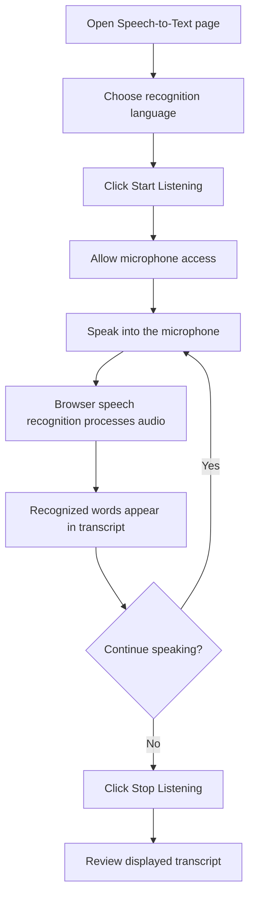
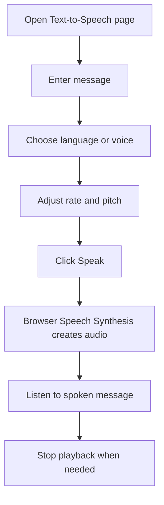
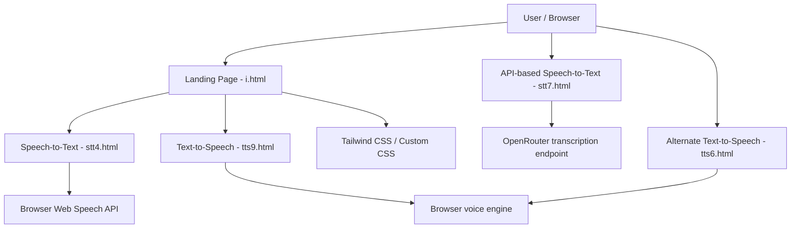

<div align="center">

# Communication Aid

### Bridging Every Conversation — One Voice and One Message at a Time

A lightweight, browser-based accessibility project that helps people with hearing and speech communication barriers interact more comfortably through **Speech-to-Text (STT)** and **Text-to-Speech (TTS)** tools.

</div>

---

## 📌 Table of Contents

- [Project Overview](#-project-overview)
- [The Problem](#-the-problem)
- [Our Approach](#-our-approach)
- [Project Goals](#-project-goals)
- [Features](#-features)
- [How the Application Works](#-how-the-application-works)
- [Application Architecture](#-application-architecture)
- [Technology Stack](#-technology-stack)
- [Project Structure](#-project-structure)
- [Getting Started](#-getting-started)
- [Using the Application](#-using-the-application)
- [Speech-to-Text Implementation Details](#-speech-to-text-implementation-details)
- [Text-to-Speech Implementation Details](#-text-to-speech-implementation-details)
- [Browser Compatibility](#-browser-compatibility)
- [Privacy and Security](#-privacy-and-security)
- [Known Limitations](#-known-limitations)
- [Troubleshooting](#-troubleshooting)
- [Future Enhancements](#-future-enhancements)
- [Contributing](#-contributing)
- [Acknowledgements](#-acknowledgements)
- [License](#-license)

---

## 🚀 Project Overview

**Communication Aid** is a web application designed to make everyday communication more accessible between people who are hard of hearing and people who communicate verbally.

The project brings two communication tools together through a central landing page:

- **Speech-to-Text:** Converts spoken words into text that another person can read.
- **Text-to-Speech:** Converts typed messages into spoken audio that another person can hear.

The application is built using HTML, CSS, and JavaScript. It uses browser speech capabilities and web technologies, so users can access the tools through a compatible browser without installing a separate desktop application.

> **Project scope:** The currently implemented tools are Speech-to-Text and Text-to-Speech. Sign-language translation is mentioned on the landing page as a broader accessibility idea, but a sign-language recognition model is not implemented in the provided project files.

---

## 🎯 The Problem

Communication can become difficult when one person is hard of hearing or has difficulty speaking while the other person relies on spoken conversation.

Common challenges include:

- Spoken information may not be accessible to someone who cannot hear it clearly.
- A person who cannot comfortably speak may need another way to communicate a message.
- Writing every message manually can take time during a live conversation.
- Communication tools should be easy to access, simple to operate, and readable on different screen sizes.

Communication Aid addresses these challenges by providing a simple text-and-voice interaction workflow.

## 💡 Our Approach

The application supports two directions of communication:

| Communication direction | Tool | What happens |
|---|---|---|
| Spoken message → readable message | Speech-to-Text | The speaker talks into a microphone and the application displays the recognized words. |
| Typed message → spoken message | Text-to-Speech | The user types a message, selects voice options, and the browser reads it aloud. |

This approach allows participants to choose the communication method that works best for them.

## 🧭 Project Goals

- Make everyday communication more accessible.
- Provide a straightforward interface with clear controls.
- Support multiple speech-recognition languages.
- Allow users to adjust text size for readability.
- Give users control over speech playback.
- Keep the application lightweight and easy to run.
- Demonstrate the use of browser-based speech technologies in an accessibility-focused project.

---

## ✨ Features

### 🏠 1. Landing Page

The main page acts as the application's navigation hub.

- Responsive navigation bar.
- Hero section introducing the project.
- Background video with an overlay for readable text.
- Feature cards linking to the STT and TTS tools.
- FAQ section with expandable answers.
- Login and sign-up modal interface.
- Mobile navigation menu.
- Scroll-based reveal animations.
- Back-to-top control.

**Note:** The login and sign-up elements are interface components in the provided static frontend. A production authentication service or user database is not included in the supplied files.

### 🎙️ 2. Speech-to-Text (STT)

The Speech-to-Text page converts speech into visible text.

- Start and stop listening controls.
- Microphone permission handling through the browser.
- Language selection.
- Live/interim and final transcript display, depending on recognition support.
- Listening status indicator.
- Animated indicator while listening.
- Adjustable transcript font size.
- Responsive layout.
- A separate API-based STT implementation is also included in the project files.

### 🔊 3. Text-to-Speech (TTS)

The Text-to-Speech page reads typed messages aloud.

- Text input area.
- Language and voice selection based on available browser voices.
- Speech rate adjustment.
- Pitch adjustment.
- Speak and stop controls.
- Playback status feedback.
- Dark-themed interface with responsive layout.

The browser's available voices determine which languages and voice styles can be selected.

### 🧩 4. Usability and Accessibility-Oriented UI

- Large text area for transcripts and typed messages.
- Font-size controls in the browser-based STT page.
- Clear listening and playback status.
- High-contrast dark/light UI sections.
- Responsive layouts for different screen sizes.
- Simple, task-focused controls.

---

## 🔄 How the Application Works

### Speech-to-Text flow



### Text-to-Speech flow



### Example conversation

1. Person A speaks: **“Can we meet at 3 PM?”**
2. The STT tool displays the recognized sentence.
3. Person B reads the message.
4. Person B types: **“Yes, that works for me.”**
5. The TTS tool speaks the typed reply aloud.

---

## 🏗️ Application Architecture

Communication Aid is a **static, client-side web application**. The provided implementation does not include a dedicated backend, database, or persistent conversation service.



### Architecture components

| Component | Responsibility |
|---|---|
| Landing page | Introduces the project and links to the communication tools. |
| STT page | Captures microphone speech and displays recognized text. |
| API STT page | Uses recorded audio and an external transcription endpoint. |
| TTS page | Converts user-entered text into browser-generated speech. |
| Browser APIs | Provide speech recognition and speech synthesis capabilities. |
| Tailwind CSS / CSS | Handles responsive layout, visual styling, and UI states. |

---

## 🛠️ Technology Stack

| Technology | Usage |
|---|---|
| HTML5 | Page structure and semantic content |
| CSS3 | Layout, custom styling, animations, and themes |
| JavaScript (Vanilla) | UI interaction and speech functionality |
| Tailwind CSS | Utility-first styling, loaded through CDN on applicable pages |
| Web Speech API – `SpeechRecognition` | Speech recognition in the browser |
| Web Speech API – `SpeechSynthesis` | Text-to-speech playback |
| `SpeechSynthesisUtterance` | Represents the text and voice settings to be spoken |
| OpenRouter transcription API | External transcription endpoint used by the API-based STT page |
| Google Fonts | Inter and Poppins typography |
| HTML5 Video | Background video on the landing page |

### Why Vanilla JavaScript?

The project focuses on a small set of browser interactions. Vanilla JavaScript keeps the implementation lightweight and avoids requiring a framework, build process, or package manager.

### Why Tailwind CSS?

Tailwind CSS makes it convenient to build responsive layouts and style buttons, cards, forms, and page sections directly through utility classes.

---

## 📁 Project Structure

The following structure reflects the intended filenames referenced by the HTML pages and the original project README. Keep linked filenames consistent when placing files in your repository.

```text
Communication-Aid/
│
├── i.html                 # Main landing page
├── stt4.html              # Speech-to-Text (browser Web Speech API)
├── stt7.html              # Speech-to-Text (API-based alternative)
├── tts9.html              # Text-to-Speech (Speak / Stop / Pause / Resume)
├── tts6.html              # Alternate Text-to-Speech implementation
├── a.mp4                  # Background video used by the landing page
└── README.md              # Project documentation
```

### File responsibilities

| File | Description |
|---|---|
| `i.html` | Main landing page, navigation, feature cards, FAQ, and modal UI. |
| `stt4.html` | Browser-native STT page using `SpeechRecognition`. |
| `stt7.html` | Alternative STT page using audio capture and an external transcription API. |
| `tts9.html` | TTS page with voice/language selection, rate and pitch controls, and playback controls. |
| `tts6.html` | Alternate TTS page with a “Generate Audio” action. |
| `a.mp4` | Background video referenced by the landing page. |

> If your repository uses different filenames, update both this documentation and the HTML links (`href` and video `src`) accordingly.

---

## ⚙️ Getting Started

### Prerequisites

- A modern browser with support for the required web APIs.
- A microphone for Speech-to-Text.
- Speakers or headphones for Text-to-Speech.
- Internet access to load CDN resources, fonts, and the external API-based STT service.
- For API-based STT, a valid OpenRouter API key configured securely.

### 1. Clone the repository

Replace the placeholder below with your actual repository URL:

```bash
git clone <your-communication-aid-repository-url>
cd Communication-Aid
```

### 2. Check the project files

Ensure the main HTML files and background video are in the expected location:

```text
i.html
stt4.html
stt7.html
tts6.html
tts9.html
a.mp4
```

### 3. Run the project

Because this is a static HTML application, there is no mandatory npm installation or compilation step.

#### Option A — VS Code Live Server

1. Open the project folder in VS Code.
2. Install the **Live Server** extension if it is not already installed.
3. Right-click `i.html`.
4. Select **Open with Live Server**.
5. Use the landing page to navigate to STT or TTS.

#### Option B — Python local server

Run the following command from the project directory:

```bash
python -m http.server 8000
```

Then open:

```text
http://localhost:8000/i.html
```

#### Option C — Direct file opening

You may open `i.html` directly in a browser. However, microphone access, speech recognition, and some browser APIs may require a secure context such as `localhost` or HTTPS. Using Live Server or another local server is recommended.

---

## 🧑‍💻 Using the Application

### Speech-to-Text

1. Open the landing page.
2. Select **Speech-to-Text**.
3. Choose the language you want to speak.
4. Click **Start Listening**.
5. Allow microphone access when prompted.
6. Speak clearly and at a comfortable pace.
7. Read the transcript displayed on the screen.
8. Use the font-size buttons if the text is too small or too large.
9. Click **Stop Listening** when finished.

**Tips for better recognition**
- Speak clearly and avoid speaking too quickly.
- Reduce background noise where possible.
- Select the closest available language/accent option.
- Keep the microphone close enough to capture speech clearly.

### Text-to-Speech

1. Open the landing page.
2. Select **Text-to-Speech**.
3. Type the message you want to communicate.
4. Select a suitable language or voice, if available.
5. Adjust the speech rate and pitch.
6. Click **Speak** or the corresponding playback button.
7. Listen to the message.
8. Use **Stop** to cancel playback.

**Tip:** Short sentences and punctuation can make spoken output easier to follow.

---

## 🎙️ Speech-to-Text Implementation Details

### Browser-native implementation (`stt4.html`)

The native STT page uses:

```javascript
const SpeechRecognition =
  window.SpeechRecognition || window.webkitSpeechRecognition;
```

The second property provides compatibility with browsers that expose the API using the WebKit-prefixed name.

The implementation configures a recognition instance and uses its event handlers to manage the interface.

| API / event | Role |
|---|---|
| `SpeechRecognition` | Creates the browser speech recognition instance. |
| `start()` | Starts recognition after the user initiates it. |
| `stop()` | Stops recognition when requested. |
| `onstart` | Updates the UI to show that listening has started. |
| `onresult` | Receives recognized speech results and updates the transcript. |
| `onend` | Updates the interface when recognition ends. |

### Language selection

The STT page contains a language dropdown. The selected language is applied to the recognition instance using its language configuration.

The language options include English, several Indian languages (including Hindi, Bengali, Gujarati, Kannada, Malayalam, Marathi, Odia, Punjabi, Tamil, Telugu, and Urdu), and selected international languages. Availability and recognition quality depend on the browser's speech service.

### Transcript readability

The transcript is displayed in a dedicated text area. Font-size controls allow the user to increase or decrease the text size for easier reading.

### API-based implementation (`stt7.html`)

The alternate STT implementation uses a different approach:

1. Captures microphone audio.
2. Collects audio data in chunks.
3. Sends audio to the OpenRouter transcription endpoint.
4. Receives a transcription response.
5. Displays the recognized text in the transcript area.

This implementation depends on an external API and network access. It should not be considered equivalent to the browser-native implementation in terms of privacy, setup, or availability.

---

## 🔊 Text-to-Speech Implementation Details

The TTS pages use the browser's speech synthesis functionality:

```javascript
const speechSynthesis = window.speechSynthesis;
const utterance = new SpeechSynthesisUtterance(text);
```

### Main APIs

| API | Purpose |
|---|---|
| `speechSynthesis.getVoices()` | Retrieves the voices available in the browser/device. |
| `SpeechSynthesisUtterance` | Creates a speech request from text. |
| `speechSynthesis.speak()` | Starts speaking the utterance. |
| `speechSynthesis.pause()` | Pauses speech playback. |
| `speechSynthesis.resume()` | Resumes paused playback. |

| `speechSynthesis.cancel()` | Stops/cancels queued speech. |

### Voice selection

The voice list is populated from the browser's available voices. The application attempts to match the selected language with a voice whose language code corresponds to that selection.

Voice availability varies by operating system, browser, and installed language packs.

### Speech rate and pitch

The TTS interface provides controls for:

- **Rate:** How quickly the message is spoken.
- **Pitch:** How high or low the voice sounds.

The selected values are applied to the speech utterance before playback.

---

## 🌐 Browser Compatibility

Speech APIs are not implemented identically in every browser.

| Browser / environment | Notes |
|---|---|
| Google Chrome | Generally a good first choice for testing browser speech features. |
| Microsoft Edge | Supports many Web Speech API features; behavior can vary by version. |
| Firefox | Speech recognition support may be limited or unavailable depending on platform/version. |
| Safari | Speech API support and behavior may differ by device and version. |
| Mobile browsers | Microphone and speech features depend on browser, OS, permissions, and device support. |

**Recommended testing environment:** A current version of Chrome or Edge, served from `localhost` or HTTPS.

Always check actual API support in the browser you are using.

---

## 🔐 Privacy and Security

Communication may include personal or sensitive information. Please consider the following:

- Microphone access is requested by the browser and should only be granted when needed.
- Browser-native speech recognition may rely on a browser/vendor speech service; do not assume audio is processed entirely offline.
- The API-based STT version sends audio to an external transcription service.
- Do not use real confidential, medical, financial, or personally identifiable information when testing the project.
- The provided static project does not implement a secure backend, account system, or persistent conversation storage.
- The login/sign-up UI should not be treated as production authentication.
- API credentials must never be committed to a public repository or embedded in frontend JavaScript.

### Important: API key handling

The uploaded API-based STT HTML file contains a client-side API key. **If that key is real or has been used, revoke/rotate it immediately.** A key placed in browser code is visible to anyone who opens the page or inspects its source.

For a safer implementation:

1. Remove the exposed key from the HTML file.
2. Create a backend endpoint to handle transcription requests.
3. Store the key in a server-side environment variable.
4. Have the frontend call your backend rather than calling the provider directly.
5. Add authentication, rate limits, request validation, and usage monitoring as appropriate.

Do not publish the existing API key in GitHub, screenshots, logs, or documentation.

---

## ⚠️ Known Limitations

- Speech recognition accuracy depends on the browser, language, accent, microphone quality, and ambient noise.
- Recognition may require an internet connection or a vendor-managed service.
- Speech recognition is not supported uniformly across browsers.
- Browser-provided TTS voices may differ across devices.
- Some languages may not have an installed or available speech synthesis voice.
- The API-based STT page requires a valid external API setup and network connectivity.
- The project does not currently include a backend database or saved conversation history.
- The login and sign-up UI is not connected to a production authentication system.
- The provided files do not implement AI-based sign-language recognition.
- This project is a communication support tool and should not be considered a certified assistive, medical, or emergency communication system.

---

## 🧰 Troubleshooting

### Speech-to-Text is not starting

- Check whether your browser supports `SpeechRecognition` or `webkitSpeechRecognition`.
- Confirm that the site is served from `localhost` or HTTPS.
- Allow microphone access in the browser.
- Check whether another application is using the microphone.
- Reload the page and try again.

### No transcript appears

- Verify the selected language.
- Speak clearly and wait briefly for recognition.
- Check microphone input settings.
- Try a supported browser such as Chrome or Edge.
- Check your internet connection if the browser uses an online recognition service.

### Text-to-Speech does not speak

- Make sure the text area is not empty.
- Check system volume and output device.
- Check whether the selected voice is available.
- Try another language or voice.
- Reload the page if the browser voice list has not populated.

### API-based STT returns an error

- Verify that the external API service is reachable.
- Check that the API key is valid and has appropriate access.
- Check network connectivity and provider usage limits.
- Inspect browser developer tools for request errors.
- Do not put a real API key directly into client-side code; use a backend proxy.

### Landing page background video is missing

- Confirm that `a.mp4` exists in the same directory as `i.html`.
- Ensure the video filename and path match the `<source>` element.
- Check that the browser can play MP4 video.

---

## 🚀 Future Enhancements

Possible next steps for the project include:

- Combine STT and TTS into one two-way conversation interface.
- Add a conversation panel that shows both transcribed and typed messages.
- Add copy, clear, and export transcript actions.
- Add saved phrase buttons for common messages.
- Improve accessibility with keyboard navigation and screen-reader labels.
- Add high-contrast themes and more adjustable text settings.
- Add support for more languages and voice options where available.
- Add an optional backend for secure API handling and conversation storage.
- Add a secure user authentication system if accounts are required.
- Explore sign-language recognition using camera input, hand-landmark detection, and a trained model (not currently implemented).
- Package the web application as a mobile app using a wrapper such as Capacitor, after reviewing platform permissions and API support.

---

## 🤝 Contributing

Contributions and suggestions are welcome.

1. Fork the repository.
2. Create a feature branch:

   ```bash
   git checkout -b feature/your-feature-name
   ```

3. Make your changes and test them in a compatible browser.
4. Commit your changes:

   ```bash
   git commit -m "Add: describe your change"
   ```

5. Push the branch:

   ```bash
   git push origin feature/your-feature-name
   ```

6. Open a Pull Request with a clear description of the change.

For accessibility-related changes, please test keyboard navigation, text readability, and the relevant speech feature before submitting.

---

## 🙏 Acknowledgements

- [MDN Web Docs](https://developer.mozilla.org/) — Web API documentation and browser development references.
- [Web Speech API](https://developer.mozilla.org/en-US/docs/Web/API/Web_Speech_API) — Browser speech recognition and speech synthesis capabilities.
- [Tailwind CSS](https://tailwindcss.com/) — Utility-first CSS framework.
- [Google Fonts](https://fonts.google.com/) — Inter and Poppins fonts.
- OpenRouter — External transcription API used in the API-based STT implementation.

---

## 📄 License

This project is licensed under the **MIT License**.

```text
MIT License

Copyright (c) 2026 Priyanshri

Permission is hereby granted, free of charge, to any person obtaining a copy
of this software and associated documentation files (the "Software"), to deal
in the Software without restriction, including without limitation the rights
to use, copy, modify, merge, publish, distribute, sublicense, and/or sell
copies of the Software, and to permit persons to whom the Software is
furnished to do so, subject to the following conditions:

The above copyright notice and this permission notice shall be included in all
copies or substantial portions of the Software.

THE SOFTWARE IS PROVIDED "AS IS", WITHOUT WARRANTY OF ANY KIND, EXPRESS OR
IMPLIED, INCLUDING BUT NOT LIMITED TO THE WARRANTIES OF MERCHANTABILITY,
FITNESS FOR A PARTICULAR PURPOSE AND NONINFRINGEMENT. IN NO EVENT SHALL THE
AUTHORS OR COPYRIGHT HOLDERS BE LIABLE FOR ANY CLAIM, DAMAGES OR OTHER
LIABILITY, WHETHER IN AN ACTION OF CONTRACT, TORT OR OTHERWISE, ARISING FROM,
OUT OF OR IN CONNECTION WITH THE SOFTWARE OR THE USE OR OTHER DEALINGS IN THE
SOFTWARE.
```

---

<div align="center">

**Communication Aid — Bridging Every Conversation.**

Built with accessibility, simplicity, and inclusive communication in mind.

</div>
